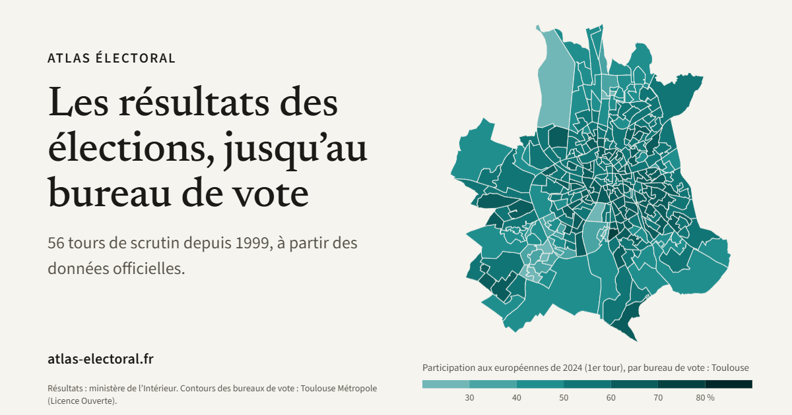

# Atlas électoral : signalements et conditions d'usage

**[atlas-electoral.fr](https://atlas-electoral.fr)** montre les résultats officiels des élections françaises (56 tours de
scrutin, de 1999 à 2026), de la France entière jusqu'au **bureau de vote** (depuis 2022 ; à la commune avant).

Le code du site n'est pas publié. Ce dépôt public sert à deux choses : **signaler une erreur**, et dire **à quelles
conditions réutiliser l'Atlas**.

## Signaler une erreur

Chaque fiche du site porte un lien « Signaler une erreur » : il ouvre le formulaire ci-dessous avec la vue affichée déjà
remplie. On peut aussi [ouvrir un ticket](https://github.com/aurelien032-glitch/atlas-electoral-signalements/issues/new?template=erreur.yml) à la main.

- Les tickets sont **publics** : n'y mettez aucune information personnelle. Un compte GitHub (gratuit) est nécessaire.
- Avant de signaler, la [Méthodologie](https://atlas-electoral.fr/?page=methodologie) dit d'où viennent les chiffres,
  comment les candidatures sont classées en blocs et ce qui manque dans les sources.

## Ce que montre le site

- **56 tours de scrutin** : présidentielles, législatives, européennes, régionales, départementales et cantonales,
  municipales.
- **Quatre cartes**, aux légendes fixes pour comparer les scrutins : *En tête* (le bloc arrivé en tête), *Score* (la
  part d'une candidature ou d'un bloc, de moins de 5 % à 80 % et plus), *Participation* (de moins de 30 % à 80 % et
  plus), *Évolution* (l'écart d'un bloc entre deux scrutins, jusqu'à ±30 points).
- **Une fiche par territoire** (bureau, commune, circonscription, département) : voix et parts, nuance officielle et
  bloc, comparaison avec le territoire qui l'englobe, « Au fil des scrutins ».
- Recherche d'une adresse, d'une commune ou d'un département ; liens partageables vers chaque vue.
- Ni cookie ni mesure d'audience ; carte utilisable au clavier et au lecteur d'écran.
- L'outil montre et cite ses sources, il ne commente pas.

## Conditions d'utilisation

- **Le code, la mise en page, les cartes et leurs légendes, le classement des candidatures en blocs** sont l'œuvre de
  l'auteur, © 2026 Aurélien Nogent ([hydroforge.fr](https://hydroforge.fr)). Le code n'est pas publié.
- **Usage non commercial : libre**, à condition de citer « Atlas électoral, atlas-electoral.fr » (avec un lien vers le
  site, ou vers la vue citée).
- **Usage commercial, ou par une organisation à titre professionnel** (entreprise, collectivité, organisme public,
  média…) : sur **accord écrit préalable** de l'auteur ([demande](https://hydroforge.fr/contact/)).
- **Fichiers de données publiés par le site** (`atlas-electoral.fr/data/v1`) : sous
  [Licence Ouverte 2.0](https://www.etalab.gouv.fr/licence-ouverte-open-licence/), avec la mention de la source
  (« Atlas électoral, d'après le ministère de l'Intérieur, data.gouv.fr »), comme les données officielles dont ils
  viennent. Seul fichier sous une autre licence : `geo/correctifs_bureaux_odbl.geojson`, tiré des « Périmètres des
  bureaux de vote » de Rennes Métropole, sous [ODbL](https://opendatacommons.org/licenses/odbl/1-0/), comme sa source.
- **Citer** : le bouton « Cite this repository » de GitHub donne la référence (fichier `CITATION.cff`).

## Sources

- Résultats : ministère de l'Intérieur, jeu « Données des élections agrégées » sur data.gouv.fr
- Contours des bureaux de vote : « Proposition de contours des bureaux de vote », data.gouv.fr (2022, indicatifs) ;
  découpages locaux publiés par les collectivités et contours « selon la méthode de l'Insee » de Cédric Rossi ; contour
  détaillé des communes sans contour de bureau : API Découpage administratif (geo.api.gouv.fr)
- Contours administratifs : IGN (ADMIN EXPRESS), versions simplifiées publiées par Etalab
- Blocs politiques : circulaire du ministère de l'Intérieur de février 2026 (INTP2602966C)

La liste complète, avec les versions et les licences, est dans la [Méthodologie](https://atlas-electoral.fr/?page=methodologie).
